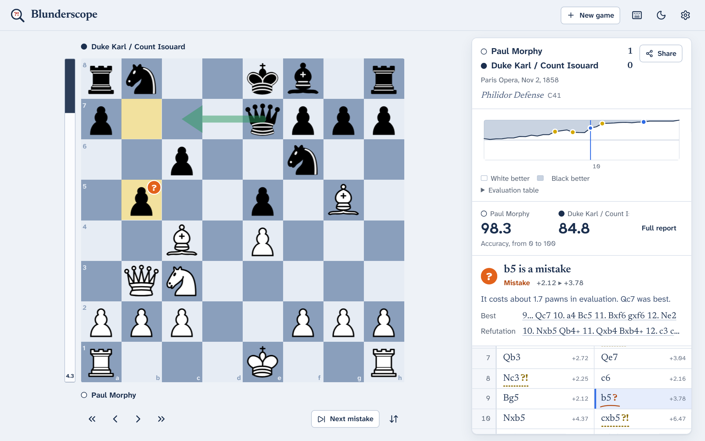
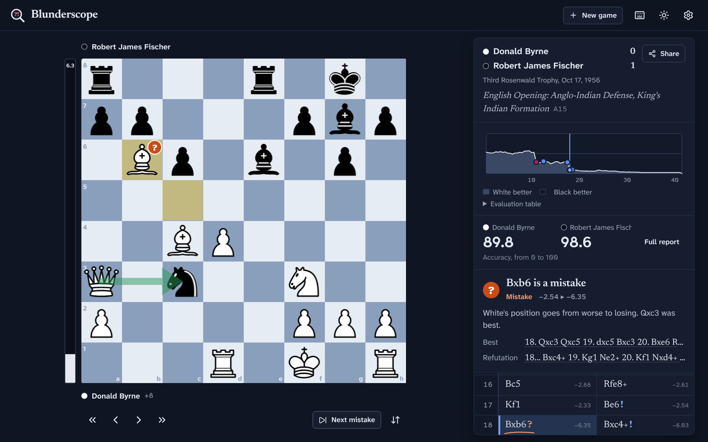
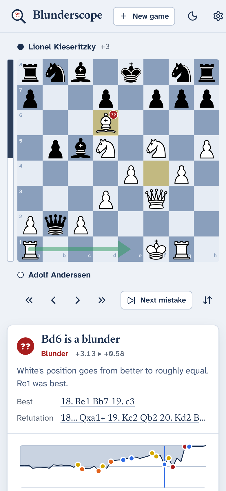

# Blunderscope

**Find the moves that decided your chess game.** Blunderscope reviews a game
move by move with Stockfish 19, right in your browser: it labels every move,
explains mistakes in plain words, shows an evaluation graph and scores each
player's accuracy. Load a PGN, a FEN, or your recent games from Lichess or
Chess.com. There is no server and no account; games never leave your device.



## Features

- **Move-by-move review.** Every move is labelled *Book, Best, Great, Excellent, Good,
  Inaccuracy, Mistake* or *Blunder*, with a badge on the board and a red-pen mark on
  the scoresheet.
- **A coach that explains.** For each move: what it cost, whether it allowed or missed a
  forced mate, the engine's better move (drawn as an arrow) and the line that refutes it.
- **Accuracy and a full report.** Accuracy per player (the Lichess formula), counts of
  every label, and average centipawn loss.
- **Evaluation graph.** White's winning chances over the whole game; hover for any move,
  click to jump there. A table view is available for screen readers.
- **Import from anywhere.** Paste PGN (multi-game files too), drop a `.pgn` file, paste a
  FEN, enter a Lichess or Chess.com username, or paste a Lichess game link.
- **Explore side lines.** Move pieces on the board or click an engine line to try ideas;
  a live engine analyzes whatever is on the board with up to 5 lines.
- **Opening names** from the Lichess opening database (3,865 named lines).
- **Keep and share.** Recent analyses are saved in the browser and reopen instantly.
  Download an annotated PGN (with `[%eval]` comments, `?!`/`?`/`??` glyphs and better lines),
  copy the FEN, or copy a link that contains the whole game.
- **Comfortable to use.** Light and dark themes, four board colors, keyboard shortcuts
  (press <kbd>?</kbd>), and a layout that works on phones.

<p>
  
  
</p>

## Publish it on GitHub Pages

The repository includes a GitHub Actions workflow that builds the app and publishes it
to GitHub Pages for free.

1. Create a new repository on GitHub (public, so Pages is free).
2. Upload **everything in this folder**, including the hidden `.github` folder
   (on a Mac, press <kbd>Cmd</kbd>+<kbd>Shift</kbd>+<kbd>.</kbd> in Finder to show it).
   Don't upload `node_modules` or `dist` if you have them.
3. In the repository, open **Settings → Pages** and set **Source** to **GitHub Actions**.
4. Open the **Actions** tab. The *Deploy to GitHub Pages* workflow runs on every push to
   `main`; run it once by hand (*Run workflow*) if it ran before step 3.
5. Your site is live at `https://<your-username>.github.io/<repository-name>/`.

The build uses relative paths, so it works under any repository name.

## Run it on your computer

You need [Node.js](https://nodejs.org) 20.19 or newer.

```bash
npm install
npm run dev        # http://localhost:5173
```

| Command | What it does |
| --- | --- |
| `npm run dev` | Development server with hot reload |
| `npm run build` | Type-check and build to `dist/` |
| `npm run preview` | Serve the production build |
| `npm test` | Unit tests (includes a full review of a game with the real engine) |
| `npm run test:e2e` | Browser tests with Playwright (run `npx playwright install chromium` once, and `npm run build` first) |
| `npm run lint` | ESLint |
| `npm run check` | Type-check, lint and unit tests together |

## How the analysis works

Stockfish 19 runs as WebAssembly in Web Workers. The single-threaded "lite" build is
used because it needs no special server headers, so it works on GitHub Pages; to make
up for it, several engines analyze different positions of the game in parallel.

Every position is searched to a fixed depth (12, 16 or 20, chosen in Settings) with the
two best lines. Evaluations are turned into **winning chances** with Lichess's model, and
each move is judged by how many percentage points of winning chances it gives away:

| Label | Rule |
| --- | --- |
| Book | Known opening theory (unless it loses 10 points or more) |
| Forced | The only legal move |
| Best | The engine's top choice |
| Great | The top choice when every other move would lose at least 20 points |
| Excellent | Loses less than 2 points |
| Good | Loses less than 5 |
| Inaccuracy | Loses 5 to 10 |
| Mistake | Loses 10 to 20 |
| Blunder | Loses 20 or more |

Accuracy follows [Lichess's published method](https://lichess.org/page/accuracy): each
move scores from 0 to 100 by the winning chances it loses, and a player's accuracy blends a
volatility-weighted mean with a harmonic mean, so a few big mistakes weigh more than many
small ones. Because the engine runs at a modest depth on your device, numbers can differ
slightly from Lichess or Chess.com reports.

## Project structure

```
src/
  lib/            Framework-free logic, fully unit tested
    chess/        PGN/FEN parsing, move conversion, annotated PGN export
    engine/       UCI protocol, engine workers, parallel game analysis
    analysis/     Winning chances, accuracy, move labels, explanations
    openings/     Opening-book lookup
    sources/      Lichess and Chess.com APIs
  state/          App state (zustand): navigation, analysis, live engine, settings
  components/     React UI: board, eval bar, graph, scoresheet, coach, dialogs
  styles/         Design tokens and CSS
  data/           Opening data and sample games
public/engine/    Stockfish 19 WebAssembly engine (see its README)
scripts/          Generator for the opening data
tests/unit/       Vitest unit tests
e2e/              Playwright browser tests
.github/          CI and GitHub Pages workflows
```

## Privacy

Analysis happens entirely in your browser. Saved analyses and settings are stored in
your browser's storage. The only network requests are to Lichess or Chess.com when you
ask to load games from them; those go straight from your browser to their public APIs.

## Credits

- [Stockfish](https://stockfishchess.org) by the Stockfish developers, compiled to
  WebAssembly by [Stockfish.js](https://github.com/nmrugg/stockfish.js) (GPL-3.0)
- [chessground](https://github.com/lichess-org/chessground) board and
  [chessops](https://github.com/niklasf/chessops) rules, by Lichess and Niklas Fiekas (GPL-3.0)
- Piece set "cburnett" by Colin M.L. Burnett (GPLv2+, bundled with chessground)
- Opening names from [lichess-org/chess-openings](https://github.com/lichess-org/chess-openings) (CC0)
- Fonts [Newsreader](https://github.com/productiontype/Newsreader) and
  [Atkinson Hyperlegible Next](https://www.brailleinstitute.org/freefont/) (SIL Open Font License)
- Icons from [Lucide](https://lucide.dev) (ISC); built with React, Vite and zustand (MIT)
- Accuracy formula and win-chance model from [Lichess](https://lichess.org) (AGPL-3.0 project; formulas reimplemented)

## License

Blunderscope is free software: you can redistribute it and/or modify it under the terms
of the GNU General Public License, version 3 or (at your option) any later version.
See [LICENSE](LICENSE). The GPL applies because the app includes Stockfish, chessground
and chessops, which are GPL-licensed.
